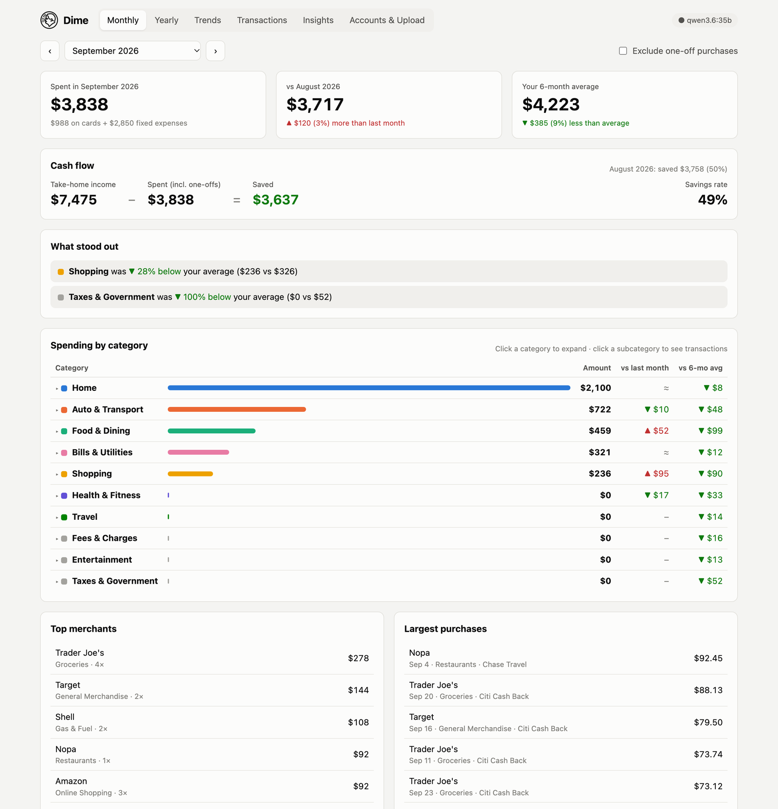
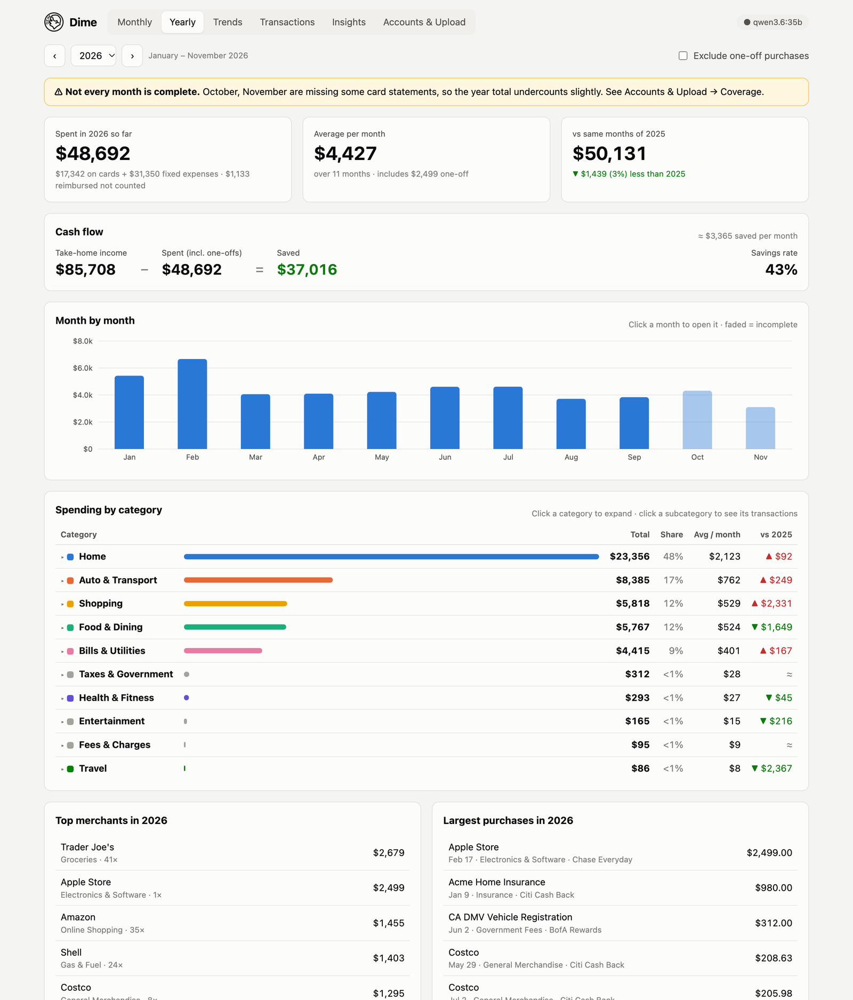
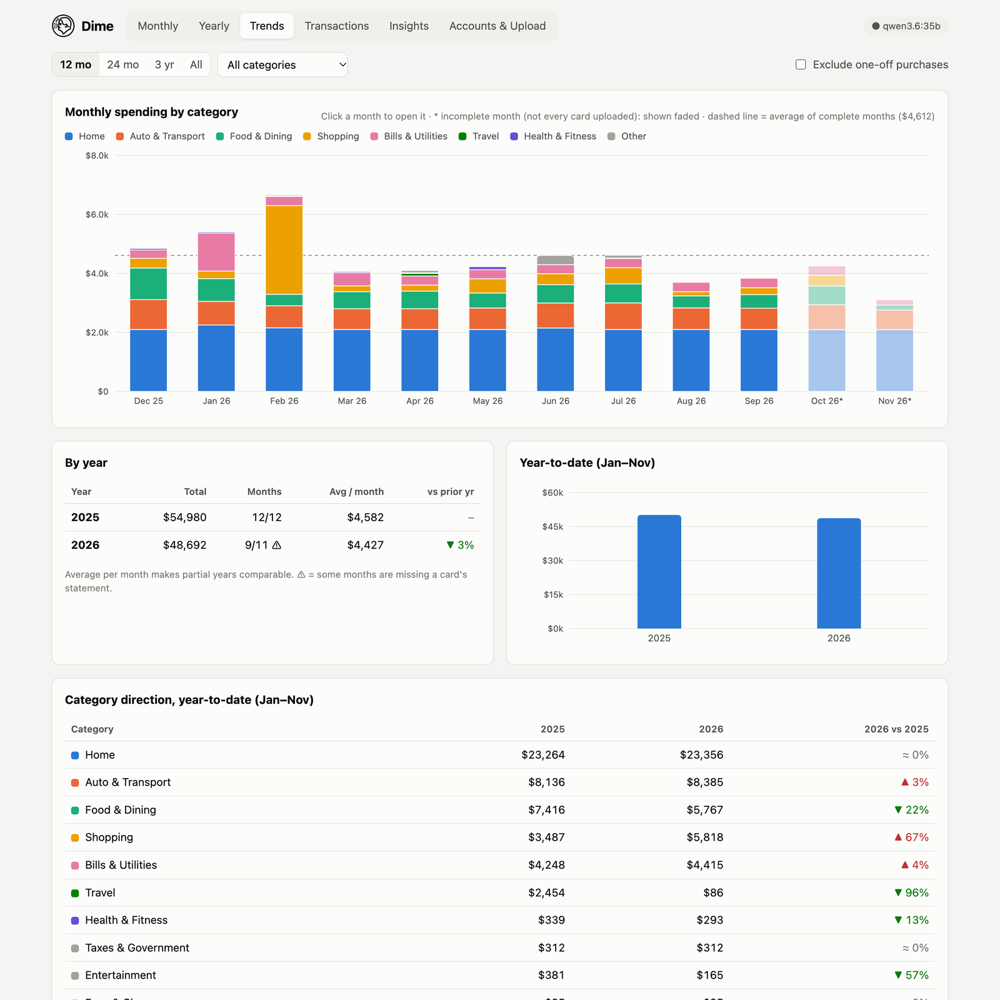
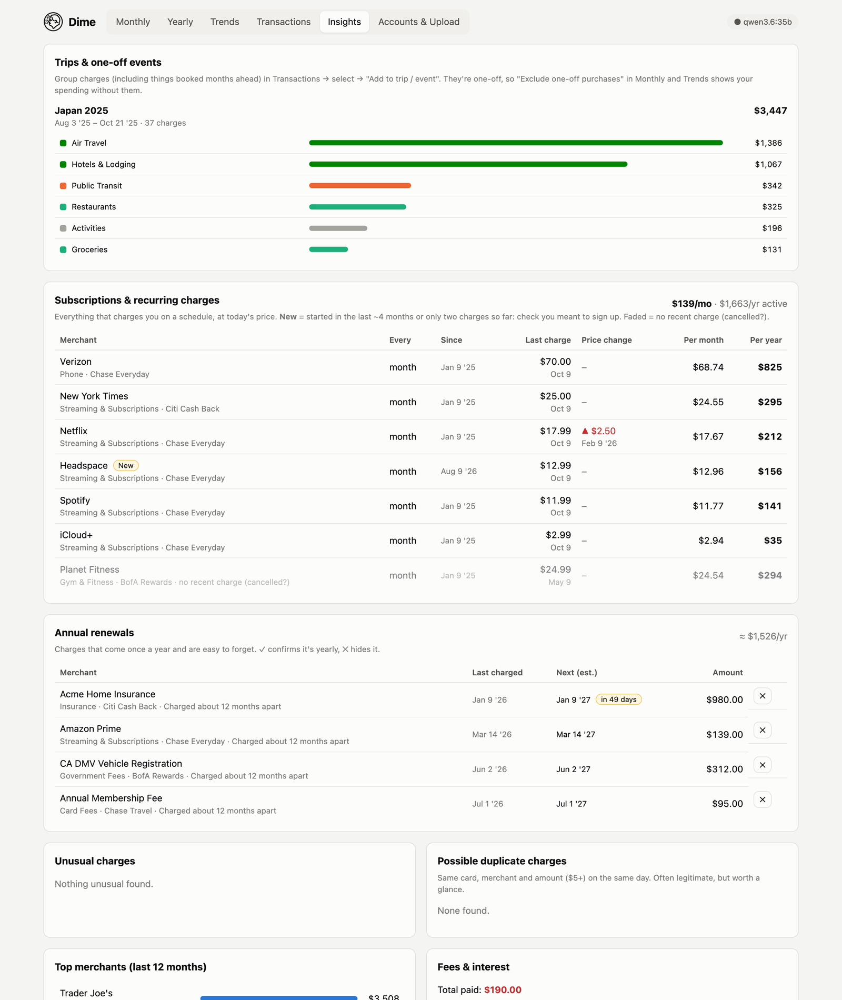
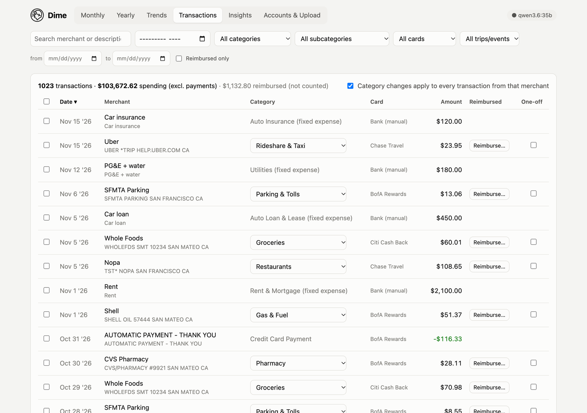
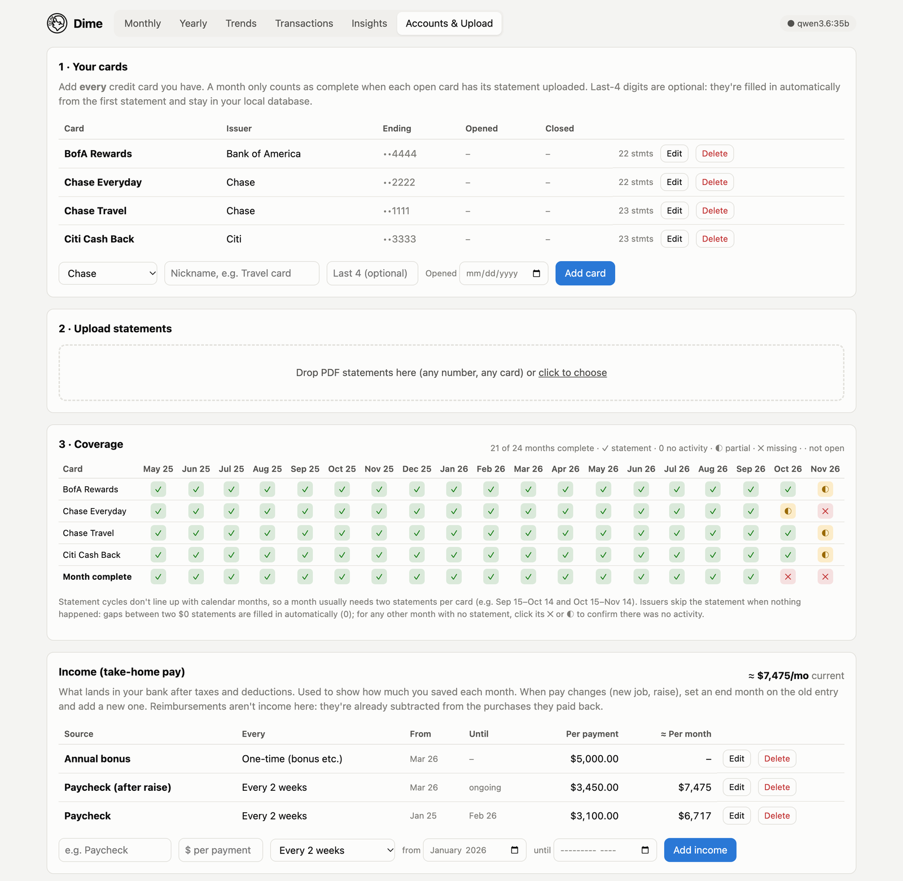

<picture>
  <source media="(prefers-color-scheme: dark)" srcset="docs/logo-white.png">
  
</picture>

# Dime

Local-only credit card statement analyzer. Drop in Chase, Citi, and Bank of America PDF statements and see
monthly spending by category, trends over time, year-over-year direction, recurring charges, and more.

Nothing leaves your machine: PDFs are parsed locally, data lives in `data/finance.db` (SQLite), and merchant
categorization runs on a local Ollama model.

<picture>
  <source media="(prefers-color-scheme: dark)" srcset="docs/screenshots/monthly-dark.png">
  
</picture>

<sub>All screenshots use the synthetic demo database (`tools/demo_data.py`), not real data.</sub>

### What's inside

**Monthly**: spending vs. last month and your 6-month average, cash flow and savings rate, and a category breakdown you can drill into down to individual transactions.

**Yearly**: the same breakdown for the whole year to date, month by month, with each category's share and change vs. the same months last year.

<picture>
  <source media="(prefers-color-scheme: dark)" srcset="docs/screenshots/yearly-dark.png">
  
</picture>

**Trends**: stacked monthly spending by category with incomplete months faded, plus year-over-year direction per category. Click any month to open it.

<picture>
  <source media="(prefers-color-scheme: dark)" srcset="docs/screenshots/trends-dark.png">
  
</picture>

**Insights**: trips and one-off events, every subscription at today's price (new, cancelled, price increases), annual renewals coming up, unusual charges and possible duplicates.

<picture>
  <source media="(prefers-color-scheme: dark)" srcset="docs/screenshots/insights-dark.png">
  
</picture>

<details>
<summary><b>Transactions</b> and <b>Accounts &amp; Upload</b></summary>

**Transactions**: search, filter by date range, card, category or trip; sort any column; re-categorize a merchant everywhere; mark reimbursements; group charges into trips.

<picture>
  <source media="(prefers-color-scheme: dark)" srcset="docs/screenshots/transactions-dark.png">
  
</picture>

**Accounts & Upload**: your cards, PDF upload, a coverage grid showing which card-months are complete, income, and fixed bank expenses.

<picture>
  <source media="(prefers-color-scheme: dark)" srcset="docs/screenshots/accounts-dark.png">
  
</picture>

</details>

## Run

```bash
./run.sh            # installs deps, builds the UI, starts Ollama + server, opens http://127.0.0.1:8000
```

Development (hot reload): `cd backend && ../.venv/bin/uvicorn app.main:app --reload --port 8000` and
`cd frontend && npm run dev` → http://127.0.0.1:5173

Try it without your own statements (synthetic data, served on a separate port):

```bash
.venv/bin/python tools/demo_data.py
cd backend && FINANCE_DATA_DIR=../demo-data ../.venv/bin/uvicorn app.main:app --port 8001   # http://127.0.0.1:8001
```

Bulk import (one folder per card, named `<issuer> <nickname>`, e.g. `chase travel card/`):

```bash
.venv/bin/python tools/import_folders.py                              # creates cards, imports every PDF, categorizes
.venv/bin/python tools/import_folders.py --confirm-no-activity 2026   # + mark 2026 months with no statement as $0
```

## How it works

**Statements & cards**
- Add every card on **Accounts & Upload**, then drop PDFs (or bulk-import folders, see above). Each statement is
  matched to a card by its last 4 digits (asked once per new card).
- A statement is only imported if `previous balance + parsed transactions = new balance`, so a parsing error can
  never silently skew totals. Parsers handle Chase, Citi and Bank of America layouts, including older ones.

**Coverage**
- A calendar month is *complete* only when every open card's statements cover every day of it; incomplete months
  are flagged and faded everywhere.
- Issuers skip the statement when nothing happened: a gap between a statement closing at $0 and the next opening at
  $0 is filled automatically, and any other statement-less month can be confirmed as "no activity" by clicking it in
  the coverage grid.

**Categories**
- Two-level taxonomy (e.g. *Food & Dining → Groceries*). Each merchant is categorized once by the local model
  (default `qwen3.6:35b`, override with `OLLAMA_MODEL`) and cached; keyword rules are the fallback if Ollama is off.
- Changing a category or renaming a merchant in **Transactions** can apply to every transaction from that merchant,
  past and future.

**What counts as spending**
- Card payments and rewards redemptions are excluded (they're *Transfers*); refunds net out in their category;
  interest and fees count under *Fees & Charges*.
- **Reimbursements**: mark a charge as fully or partly reimbursed (one at a time or in bulk); only what you actually
  paid counts. The original amount stays visible.
- **Fixed expenses** paid from the bank (mortgage, insurance, utilities…) are entered once and added every period
  (monthly / quarterly / yearly), so totals reflect the whole picture.

**Income & savings**
- Enter take-home pay (monthly, twice a month, every 2 weeks, or one-time like a bonus) with start/end months, so a
  raise or job change is just a new entry. Monthly and Yearly then show income − spending = saved and the savings
  rate, always based on actual spending (one-offs included).

**Trips & one-offs**
- Select charges in **Transactions** (including things booked months ahead) and add them to a trip or event.
  Tagged charges are *one-off*: "Exclude one-off purchases" in Monthly, Yearly and Trends shows your normal spending
  without them, and **Insights** shows each trip's total by category.

**Subscriptions & renewals** (in **Insights**)
- Recurring charges are detected automatically and shown at today's price with a per-month and per-year cost,
  including price increases, brand-new subscriptions (flagged **New** after just two charges) and ones that stopped.
- **Annual renewals** catches once-a-year charges (insurance, registrations, card annual fees, memberships) with the
  next expected date; ✓ / ✕ confirm or hide a suggestion.
- Also: unusual charges for a merchant, possible duplicate charges, fees & interest, and top merchants.

## Layout

```
backend/app/parsers/   issuer detection + Chase/Citi/BofA parsers (amounts in integer cents)
backend/app/           FastAPI app, SQLite schema, analytics, Ollama categorizer
frontend/src/          React + Recharts UI
tools/                 import_folders.py, demo_data.py, redact_skeleton.py + check_parsers.py (privacy-safe debugging)
docs/screenshots/      README images (demo data)
data/                  your database and uploaded PDFs (gitignored)
```

If a statement fails to balance (e.g. an older layout), run `.venv/bin/python tools/check_parsers.py <folder> --show`.
It prints a masked report (no names or account numbers) that's safe to share for debugging.

## Privacy & sharing

All personal data lives outside version control: statement PDFs (anywhere), `data/` (SQLite database + uploaded
copies), `redacted/` and `statements/` are gitignored. The code contains no personal values, so the repo can be
shared as-is; each person gets an empty database on first run and adds their own cards, statements, income and
fixed expenses. Requirements: Python 3.12+, Node 20+, and optionally [Ollama](https://ollama.com) with any
instruction-following model (`OLLAMA_MODEL=...`; without it, categorization falls back to keyword rules).
# dime
